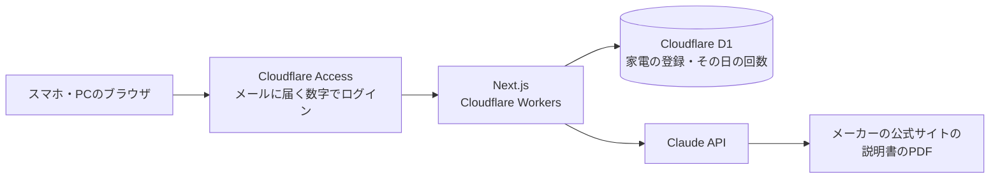
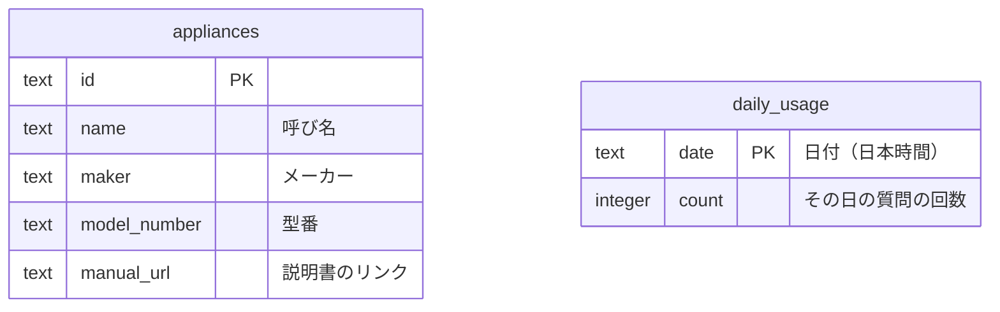

# sorenavi — 要件定義書・設計書

> 商品の「今の姿」（何を作るか・どう作るか・やらないこと）を書く場所。置き場所は`docs/design-spec.md`。なぜ作るか・誰向けか・将来やることは`planning.md`、後から変えるのが大変な判断の経緯は`decisions/`に書き、ここには重ねて書かない。実装コードそのもの（関数の中身・スキーマ全文・APIルートの中身等）は書き写さない。コードが変われば記録側は更新されず食い違って腐るため、詳細はコード自体を参照する。該当しないセクションは書かない。

## 機能要件（必須）

### 1. ログイン

- 許可した自分のメールアドレスだけがログインできる。ログインしていない人には、何も見えず、何も使えない
- ログアウトできる

### 2. 家電の登録

- 呼び名（例：洗濯機）・メーカー・型番・説明書のリンクを入れて登録すると、家電の一覧に出る
- 説明書のリンクは、メーカーの公式サイトにある取扱説明書のPDFのリンク。1つの家電に1つだけ
- リンクは、httpsで始まり、2,000文字までで、ユーザー名やパスワードが入っていないものだけ受け付ける。合わない時は、登録せずに理由を出す
- パナソニックの家電は対象外にする（利用条件が、説明書を許可なく写す・送ることを禁じているため）。パナソニックの公式サイトのリンクは、登録の時に断る
- 登録の画面に、次の2つを出す（初めての登録で、説明書のリンクを探すのが一番難しいため）
  - 「メーカー名＋型番＋取扱説明書」でWeb検索するボタン（検索結果を新しいタブで開くだけ。アプリが説明書を取ってくるのではない）
  - PDFを開いて、そのアドレスをコピーして貼る手順（番号付き）
- 一覧から、その家電の説明書（公式のリンク）を新しいタブで開ける
- 1つも登録していない時は、一覧に「まず家電を登録」と、登録の画面へのボタンを出す

### 3. チャットの形で質問

- **危ない時**：質問に危ない言葉（煙・焦げ・異臭・水漏れ・火花・感電など。言葉の一覧はコードで決める）が入っていたら、AIを呼ぶ前に、決まった警告をコードで出す
  - 警告の文は、煙・においの時と、水漏れの時で分ける。中身は、公的機関の資料を元に作る
  - この警告は、回数に数えず、回数や料金の上限に達していても出す
  - AIの答えに危ない言葉が入っていた時も、答えの上に同じ警告を足す
- ふつうの文で質問すると（例：「洗濯機がE211」）、登録の中からどの家電の話かを選ぶ
  - 同じ種類が2台以上あり、質問に型番・メーカー・呼び名の手がかりが無い時は、聞き返す。候補の家電をボタンで出し、押して選ぶ
  - 登録していない家電のことを聞かれた時は、「その家電は登録されていない」と伝え、登録の画面へのボタンを出す
  - 1つも登録していない時は、質問の画面に「まず家電を登録」と、登録の画面へのボタンを出す
- 選んだ家電の説明書だけを元に、意味と直し方を、自分の言葉で、結論から答える
  - 説明書の何ページに書いてあるか（PDFの何ページ目か。1から数える）を添える
  - 説明書を開くボタンを添える。押すと、そのページを新しいタブで開く
  - 説明書に無いことは、「説明書には書いていない」と答える
  - 説明書に修理の相談先が書いてあれば、答えの最後に必ず添える（直らない時に行き止まりにしないため）
- AIの答えは、文字として出す。画像・リンク・HTMLとして描かない
- 前の答えを受けて、続けて聞ける（「やってみたけど直らない」など）
- 1つの会話は1つの家電について話す。最初の質問で家電を決め、その会話の間は同じ説明書で答える。別の家電の話になったら、新しい会話を始めるよう伝える
- 会話と打ちかけの質問は、ブラウザのタブを閉じるまで、そのタブの中にだけ置く（読み込み直しやログイン切れで消えないように）。タブを閉じたら消える。DBには残さない
- 説明書のリンクが切れていて読めない時は、どの家電のリンクかを伝え、その家電の登録を直す画面へのボタンを出す。打った質問は消さず、リンクを直した後にそのまま聞き直せる
- 止まった時（1日の回数・会話の回数・文字数・月の上限・混雑・ログイン切れ）は、理由ごとに決まった文言と、次にできること（例：「明日の0時に戻ります」「新しい会話を始める」「ページを読み込み直す」）を出す。打った質問は消さない

### 4. 家電の登録を直す・消す

- 登録した家電の呼び名・メーカー・型番・説明書のリンクを直せる（受け付けるリンクは「2. 家電の登録」と同じ）
- 登録した家電を消せる。消す前に、確認を挟む

## 権限の表（ログインやDBがある商品は必須）

| データ | 自分（ログインした人） | ログインしていない人 |
| --- | --- | --- |
| 家電の登録（説明書のリンクを含む） | 読む・作る・直す・消す | 何もできない |
| AIへの質問 | できる | できない |

## 何が起きうるか（ログイン・DB・外部への送信・AIのどれかがある商品は必須）

- **なりすまし**：他人がログインして使う → Cloudflare Accessで、許可した自分のメールアドレス1つだけを通す（ほかのアドレスには、ログインの数字が届かない）。許可するアドレスはCloudflareの管理画面とサーバーの秘密の設定に置き、リポジトリには書かない
- **Accessのすり抜け**：Accessを通らない入口（プレビューのURLなど）から開く → Accessは、URLごとではなくWorker全体（公開に使うworkers.devのURLを含む）に掛ける。プレビューのURLは、Workerの設定ファイルで止める（管理画面だけで止めると、次の公開で戻るため）。公開した後に、ログインせずに開くと断られることを確かめる
- **のぞき見**：ログインしていない人が、家電の一覧や答えを見る → サーバーは、Accessが渡す証明（`Cf-Access-Jwt-Assertion`のJWT）の署名・発行元（チームのドメイン）・宛先（アプリのAUD）・メールアドレスを、DBやAIに触る所の入口で毎回確かめる（Next.jsのmiddlewareだけに頼らない）。確かめに要る設定が空なら通さない。確かめを飛ばす作りは、開発用にも置かない。D1は外から直接つながらず、サーバーの中からしか使えない
- **書き換え・削除**：他人が家電の登録を変える・消す → 上と同じ。読み書きできるのは自分だけ
- **外のサイトから勝手に送らせる（CSRF）**：別のサイトを開いた自分のブラウザから、質問を勝手に送られる → 送るたびに、送り元（Origin）が自分のサイトかを確かめ、JSONだけ受け付ける
- **使いすぎ**：AIの窓口を何度も叩かれて、利用料が膨らむ → ログインしないと使えない。回数の制限と利用料の上限も付ける（「AIを使う商品の項目」）。ブラウザから受け取るのは、家電のID・質問・会話だけにし、説明書のリンクはサーバーがDBから引く（登録していない物を読ませないため）。AIの自動のやり直しは1回までにし、答えの長さの上限（`max_tokens`）を必ず付ける
- **秘密の値**：AnthropicのAPIの鍵がブラウザやリポジトリに出る → 前の作りでは、ビルドで作られるフォルダ（`.open-next`）に鍵が入り、gitの履歴に残った。なので次のようにする
  - 鍵は、本番で動く時だけ使う（Workersのsecretに置く）。ビルドの時には渡さない
  - 手元の開発では、上限を低くした別の鍵を、Gitに入らないファイル（`.dev.vars`）に置く
  - ビルドで作られるフォルダ（`.open-next`・`.next`・`.wrangler`）はGitに入れない。CIでは、リポジトリとビルドの出力の両方を、秘密の値の検出（gitleaks）で調べる
  - リポジトリは公開するので、GitHubの秘密の値の検出と、鍵を含むpushを止める機能もオンにする
  - 漏れた時は、その鍵を無効にし、新しい鍵をWorkersのsecretに入れ直す。月10ドルの上限が、漏れた時の被害の上限にもなる
- **AIへの紛れ込んだ指示**：説明書のPDFやリンク先に、AIへの指示が書かれている → AIの答えは画面に文字として出すだけにする（画像として描くと、画像のアドレスに会話を載せて外へ送らせる手口があるため）。説明書を開くボタンのリンクは、AIの答えからではなく、サーバーがDBから付ける。CSP（ページが読み込んでよい先を決める設定）で、自分のサイト以外への読み込み・送信を止める。AIには道具を持たせず、DBへの書き込みなどの操作をさせない。説明書は信頼できない資料として扱うよう、AIへの指示に書く
- **危ない答え**：AIが間違った直し方を答えて、感電や水漏れにつながる → 説明書に書いてあることだけで答え、ページ番号を添える（自分で説明書と見比べられる）。危ない時の警告は、AIに任せず、コードで決まった文を出す（「機能要件3」）
- **ログに残る**：質問の中身などが、Workersのログやエラーの画面に残る → 質問の本文・メールアドレス・説明書のリンク・Accessの証明は、ログに出さない。エラーは決まった文言で返し、AnthropicのエラーやErrorの中身を画面に出さない

## AIを使う商品の項目（AIを使う商品は必須）

- **回数の制限**：1日20回まで
  - 送信を押した回数で数える。2段階で処理しても1回。AIがエラーで答えられなかった時は、数えた分を戻す。危ない時の警告だけを出した時は数えない
  - 「1つ足す」と「20未満か」は、SQLの1文で同時に行う（同時に何件も送られても、21回目を通さないため）
  - 日付は日本時間で区切る
  - 1つの会話で続けて聞けるのは10回まで。ただし会話はブラウザから届くので、ごまかせる。本当の歯止めは、1日20回と月10ドルの上限
- **利用料の上限**：Claude Consoleに、sorenavi専用のワークスペースを作り、月10ドルの上限を付ける。上限に達すると、その月の終わりまでAIが止まる。専用にするのは、ほかの商品と上限を分けるため（最初からあるワークスペースには上限を付けられない。[公式の説明](https://platform.claude.com/docs/en/api/rate-limits)）
  - Consoleで、使った金額の通知も付ける（例：3ドル・7ドル）。1日で使い切って、1か月止まるのを早く知るため
  - 上限に達した時は、APIの応答で見分けて、「今月の上限に達しました」と出す。自分で付けた上限は、400で決まった文言（`You have reached your specified workspace API usage limits`）で始まる。組織全体の上限は429。リンクが読めない時の応答と取り違えないよう、見分け方を1か所にまとめる
  - AIの答えを確かめる問題集は、別のワークスペースと別の鍵で流す（アプリの月10ドルを食わないため）
  - 1回の料金の目安：説明書が60ページなら、最初の1回はSonnet 5.5で約0.35ドル、Opus 5.5で約0.7ドル。5分以内に続けて聞く分は、プロンプトキャッシュで約0.03ドル（3ページで約7,000トークンとして計算。AIが考える分のトークンは入れていない。リンクで渡したPDFにプロンプトキャッシュが効くかは未確認）
- **入力の長さ**：1回の質問は500文字まで。超えたらAIに送らずに知らせる
- **AIに渡す権限**：AIの答えは画面に出すだけ。DBへの書き込みや、外へ送る操作はさせない。Web検索などの道具も持たせない（説明書だけで答えるため）。AIに渡すのは、家電の一覧（呼び名・メーカー・型番）・会話・選ばれた家電の説明書だけ

## 非機能要件（任意・推奨）

- **性能**：答えは、できた所から順に表示する（説明書が長いと、答えが出るまで待つため）。待ち時間は、作り始めの最初のタスクで測る
- **可用性**：自分用なので、止まらない時間の目標は決めない。ただし、何週間も使わなくても、使いたい時にすぐ使える（困った時にしか開かないため）
- **運用の目標**：止まっても、使う時に気づけばよい（外からの死活監視はしない）
- **バックアップ**：取らない（理由：消えても、家電を登録し直せば済むため）
- **セキュリティ**：「権限の表」「何が起きうるか」のとおり
- **拡張性**：先回りして作らない。薬・説明書を複数持てる形などは、要る時にDBの変更で足す
- **保守性**：AIの答えを確かめる問題集を作る
  - 本物の説明書で、「質問と、答えに入っているべきこと」の組を5つほど用意する。入っているべきことは、ページ番号・「書いていない」・危ない時の警告が先に出るか、など決まった言葉で見る
  - 「同じ種類が2台」「登録していない家電」「似た名前の2台」の質問も入れる
  - CIには入れず、モデルやAIへの指示を変えた時に、手で流す（1回で約2ドル。答えが毎回少しずつ違い、自動の合否に向かないため）
  - 問題集には、説明書のリンク・質問・自分の言葉で書いた要点だけを入れる
- **移行性**：DBの変更はマイグレーションで行い、今あるデータを壊さない。前の作り（薬）のデータは引き継がない
- **対応環境**：主にスマホ、PCでも使える。Chrome・Safari・Edgeの最新版で動く
- **使いやすさ**：答えは結論から短く書き、手順には番号を付ける。スマホのホーム画面にアイコンを置ける（聞くまでを速くするため）。文字の大きさ・押す所の大きさなどは[ui-rules.md](ui-rules.md)
- **公開・非公開**：リポジトリは公開する。アプリを使えるのは自分だけ（Accessで自分のメールアドレスだけを通す）。許可するメールアドレス・鍵・説明書のPDFと文章は、リポジトリに入れない。機密情報・個人情報は、どこにも書かない（`AGENTS.md`の共通の決まり）

## 技術選定（任意・推奨）

- **画面とサーバー：Next.jsをCloudflare Workersで動かす**。ほかの商品と同じ作りで、無料で使えるため（[decisions/0001](decisions/0001-host-on-cloudflare-workers-and-d1.md)）。無料プランの制限（大きさ・1回の計算時間）に収まるかは、作り始めの最初のタスクで測る。Next.js・Reactは、始める時点の最新の修正版にする
- **DB：Cloudflare D1（ORMなし）**。使わない期間があっても止まらず、無料で使えるため。表が2つなので、ORMは使わない（[decisions/0001](decisions/0001-host-on-cloudflare-workers-and-d1.md)）
- **ログイン：Cloudflare Access（メールに届く数字）**。ログインの仕組みを自分で作らずに済み、許可する相手をリポジトリの外に置けるため（[decisions/0002](decisions/0002-login-with-cloudflare-access.md)）
- **画面の部品：shadcn/ui＋Tailwind、文字はNoto Sans JP**。ほかの商品で慣れている。文字は、画面設計に使った部品集のフォント（Inter）では日本語が出ないため
- **AI：Anthropicの公式のSDK（TypeScript）でClaude APIを呼ぶ**。モデルは、作り始めの最初のタスクで問題集を使い、Sonnet 5.5とOpus 5.5を比べて決める
  - 家電選びは、決まった形のJSON（構造化出力）で「選んだ・聞き返す・未登録」を返させる。文章で返させると、サーバーが見分けられないため
  - ページ番号は、APIの出典の機能（citations）が返すページを正とする。AIが文で書く番号より確かなため
- **説明書の渡し方：利用者が貼った公式のPDFのリンクを、そのままClaude APIに渡す**。アプリは説明書を保存しない（[decisions/0003](decisions/0003-pass-manual-by-official-link.md)。確かめた中身は[tech-check.md](tech-check.md)）

## Non-Goals・スコープ外（任意・推奨）

このバージョンでは扱わない範囲。詳細は`planning.md`の「将来構想」を参照。

- 型番や写真から、説明書を自動で取ってくる
- 説明書のPDFをアプリに入れる（リンクで読めないメーカーが出たら足す。足すとしても自分用だけで、ほかの人に公開する時には入れない）
- パナソニックの家電
- 1つの家電に、説明書を2つ以上登録する
- 会話を残す（修理の記録）
- ほかの人に使ってもらう・収益化・薬・家電以外の説明書（公開する前の法律の確認は[legal-review.md](legal-review.md)）

## 検討して採らなかった案（任意）

- **登録の時に、サーバーからリンク先を取りに行って、読めるかを確かめる**：サーバーが、言われた場所へ何でも取りに行く入口（SSRF）になるため。自分用なら、最初の質問で分かれば足りる。公開する時に、メーカーの公式ドメインの許可リストとあわせて考え直す（2026-10-30のレビュー）
- **鍵がコミットされる前に止める仕組み（pre-commitのgitleaks）**：鍵はビルドに渡さず、置く場所はGitに入らないファイルとWorkersのsecretだけにするので、入る道がほぼ無いため。CIとGitHubの検出で足りる（同）
- **1日の残りの回数を、画面にいつも出す**：自分用では要らないため。公開する時に考える（同）
- **「直す」「説明書のリンク」などの言葉を、家電が苦手な人向けに言い換える**：自分用では今の言葉で分かるため。公開する時に考える（同）

## アーキテクチャ（任意・推奨）

- 質問は3段階で処理する
  1. 質問に危ない言葉が入っているかを、コードで調べる。入っていたら、決まった警告を先に出す
  2. 説明書を送らずに、質問と家電の一覧だけをAIに渡し、どの家電の話かを決まった形で返させる（選んだ・聞き返す・未登録）
  3. 選んだ家電の説明書のリンク（サーバーがDBから引く）と会話をAIに渡す。説明書はAnthropic側がメーカーのサイトへ取りに行き、それを読んで答える
- 会話はブラウザのタブの中にだけ置き、聞くたびにサーバーへ送る（DBには残さない）

## 画面設計（任意）

[Figma](https://www.figma.com/design/WACctY3a5FVyzyzHPSlrW6/sorenavi?node-id=0-1)（ページ「画面」。スマホは390幅、PCは1440幅）

- スマホ：[質問（はじめ）](https://www.figma.com/design/WACctY3a5FVyzyzHPSlrW6/sorenavi?node-id=3-329)／[質問（答え）](https://www.figma.com/design/WACctY3a5FVyzyzHPSlrW6/sorenavi?node-id=3-399)（縦にスクロール）／[質問（登録していない家電）](https://www.figma.com/design/WACctY3a5FVyzyzHPSlrW6/sorenavi?node-id=3-487)／[家電の一覧](https://www.figma.com/design/WACctY3a5FVyzyzHPSlrW6/sorenavi?node-id=3-539)／[家電の登録・直す](https://www.figma.com/design/WACctY3a5FVyzyzHPSlrW6/sorenavi?node-id=3-622)
- PC：[質問（答え）](https://www.figma.com/design/WACctY3a5FVyzyzHPSlrW6/sorenavi?node-id=4-203)／[家電の一覧](https://www.figma.com/design/WACctY3a5FVyzyzHPSlrW6/sorenavi?node-id=4-303)／[家電の登録・直す](https://www.figma.com/design/WACctY3a5FVyzyzHPSlrW6/sorenavi?node-id=4-384)
- 部品（下のタブ・PCのヘッダー・家電の行・自分の質問・AIの答え）は、同じページの「部品」にまとめている
- 2026-10-30のレビューの直しは、部品（家電の行・答えの「説明書を開く」のボタン・PCのヘッダー）にだけ入っている。各画面のボタンの大きさ（44px）・危ない時の帯の文・登録の画面の「説明書の探し方」・「家電が0件」と「聞き返し」の画面は、まだ入っていない（FigmaのMCPの月の上限のため。2026年11月に入れる）。食い違う所は、機能要件と[ui-rules.md](ui-rules.md)を正とする

画面の見た目・操作の決まり：[ui-rules.md](ui-rules.md)

## データ構造（任意・推奨）

- `appliances`：登録した家電。1行が家電1つ
- `daily_usage`：1日20回の制限を数えるための表。1行が1日
