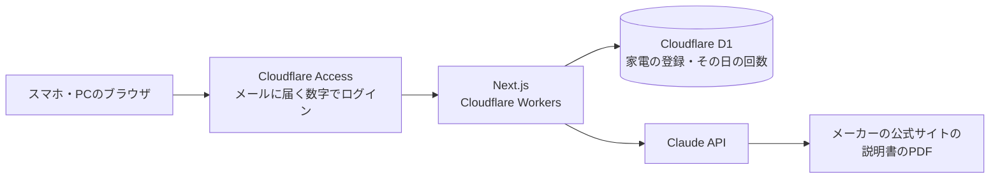
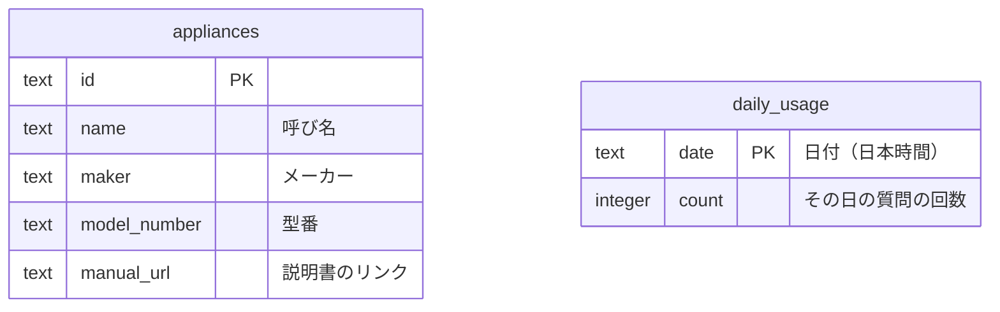

# sorenavi — 要件定義書・設計書

> 商品の「今の姿」（何を作るか・どう作るか・やらないこと）を書く場所。置き場所は`docs/design-spec.md`。なぜ作るか・誰向けか・将来やることは`planning.md`、後から変えるのが大変な判断の経緯は`decisions/`に書き、ここには重ねて書かない。実装コードそのもの（関数の中身・スキーマ全文・APIルートの中身等）は書き写さない。コードが変われば記録側は更新されず食い違って腐るため、詳細はコード自体を参照する。該当しないセクションは書かない。

## 機能要件（必須）

### 1. ログイン

- 許可した自分のメールアドレスだけがログインできる。ログインしていない人には、何も見えず、何も使えない
- ログアウトできる

### 2. 家電の登録

- 呼び名（例：洗濯機）・メーカー・型番・説明書のリンクを入れて登録すると、家電の一覧に出る
- 説明書のリンクは、メーカーの公式サイトにある取扱説明書のPDFのリンク。1つの家電に1つだけ
- 一覧から、その家電の説明書（公式のリンク）を開ける

### 3. チャットの形で質問

- ふつうの文で質問すると（例：「洗濯機がE211」）、登録の中からどの家電の話かを選び、その家電の説明書だけを元に、意味と直し方を自分の言葉で答える
- 答えには、説明書の何ページに書いてあるかと、説明書のリンクを添える
- 説明書に無いことは、「説明書には書いていない」と答える
- 前の答えを受けて、続けて聞ける（「やってみたけど直らない」など）
- 1つの会話は1つの家電について話す。最初の質問で家電を決め、その会話の間は同じ説明書で答える。別の家電の話になったら、新しい会話を始めるよう伝える
- 会話は残さない。画面を閉じたら消える
- 登録の中のどれか分からない時（洗濯機が2台ある時など）は、聞き返す
- 登録していない家電のことを聞かれた時は、「その家電は登録されていない」と伝え、登録の画面へのボタンを出す。まだ1つも登録していない時も同じ
- 煙・焦げたにおい・水漏れなどが書かれていたら、答えより先に、使うのをやめるよう伝える
- 説明書のリンクが切れていて読めない時は、どの家電のリンクかを伝え、その家電の登録を直す画面へのボタンを出す。打った質問は消さず、リンクを直した後にそのまま聞き直せる

### 4. 家電の登録を直す・消す

- 登録した家電の呼び名・メーカー・型番・説明書のリンクを直せる
- 登録した家電を消せる

## 権限の表（ログインやDBがある商品は必須）

| データ | 自分（ログインした人） | ログインしていない人 |
| --- | --- | --- |
| 家電の登録（説明書のリンクを含む） | 読む・作る・直す・消す | 何もできない |
| AIへの質問 | できる | できない |

## 何が起きうるか（ログイン・DB・外部への送信・AIのどれかがある商品は必須）

- **なりすまし**：他人がログインして使う → Cloudflare Accessで、許可した自分のメールアドレスだけを通す（ほかのアドレスには、ログインの数字が届かない）。許可するアドレスはCloudflareの管理画面に置き、リポジトリには書かない
- **のぞき見**：ログインしていない人が、家電の一覧や答えを見る → Accessを通らないと、アプリに届かない。サーバーでも、Accessが渡す「通ってよい」という証明（JWT）を毎回確かめる。D1は外から直接つながらず、サーバーの中からしか使えない
- **書き換え・削除**：他人が家電の登録を変える・消す → 上と同じ。読み書きできるのは自分だけ
- **使いすぎ**：AIの窓口を何度も叩かれて、利用料が膨らむ → ログインしないと使えない。回数の制限と利用料の上限も付ける（「AIを使う商品の項目」）
- **秘密の値**：AnthropicのAPIの鍵がブラウザやリポジトリに出る → 鍵はサーバー側だけで使う。前の作りでは、ビルドで作られるフォルダ（`.open-next`）に鍵が入り、gitの履歴に残った。ビルドで作られるフォルダはGitに入れず、CIで秘密の値を自動で探す（gitleaks）。リポジトリは公開するので、GitHubの秘密の値の検出と、鍵を含むpushを止める機能もオンにする
- **AIへの紛れ込んだ指示**：説明書のPDFやリンク先に、AIへの指示が書かれている → AIの答えは画面に出すだけにする。AIの答えで、DBへの書き込みなどの操作をさせない
- **危ない答え**：AIが間違った直し方を答えて、感電や水漏れにつながる → 説明書に書いてあることだけで答え、ページ番号を添える（自分で説明書と見比べられる）。煙・焦げたにおい・水漏れなどの時は、答えより先に使うのをやめるよう伝える

## AIを使う商品の項目（AIを使う商品は必須）

- **回数の制限**：1日20回まで（続けて聞いた分も1回と数える。日付は日本時間で区切る）。1つの会話で続けて聞けるのは10回まで
- **利用料の上限**：Claude Consoleに、sorenavi専用のワークスペースを作り、月10ドルの上限を付ける。上限に達すると、その月の終わりまでAIが止まる。止まった時は、画面に「今月の上限に達しました」と出す。専用にするのは、ほかの商品と上限を分けるため（最初からあるワークスペースには上限を付けられない。[公式の説明](https://platform.claude.com/docs/en/api/rate-limits)）
  - 1回の料金の目安：説明書が60ページなら、最初の1回はSonnet 5.5で約0.35ドル、Opus 5.5で約0.7ドル。5分以内に続けて聞く分は、プロンプトキャッシュで約0.03ドル（3ページで約7,000トークンとして計算。リンクで渡したPDFにプロンプトキャッシュが効くかは未確認）
- **入力の長さ**：1回の質問は500文字まで。超えたらAIに送らずに知らせる
- **AIに渡す権限**：AIの答えは画面に出すだけ。DBへの書き込みや、外へ送る操作はさせない。Web検索などの道具も持たせない（説明書だけで答えるため）。AIに渡すのは、家電の一覧（呼び名・メーカー・型番）・会話・選ばれた家電の説明書だけ

## 非機能要件（任意・推奨）

- **性能**：答えは、できた所から順に表示する（説明書が長いと、答えが出るまで待つため）。待ち時間は、作り始めの最初のタスクで測る
- **可用性**：自分用なので、止まらない時間の目標は決めない。ただし、何週間も使わなくても、使いたい時にすぐ使える（困った時にしか開かないため）
- **運用の目標**：止まっても、使う時に気づけばよい（外からの死活監視はしない）
- **バックアップ**：取らない（理由：消えても、家電を登録し直せば済むため）
- **セキュリティ**：「権限の表」「何が起きうるか」のとおり
- **拡張性**：先回りして作らない。薬・説明書を複数持てる形などは、要る時にDBの変更で足す
- **保守性**：AIの答えを確かめる問題集を作る。本物の説明書で「質問と、答えに入っているべきこと（ページ番号など）」の組を5つほど用意し、モデルやAIへの指示を変えた時に流す（1回で約2ドル）。問題集には、説明書のリンク・質問・自分の言葉で書いた要点だけを入れる
- **移行性**：DBの変更はマイグレーションで行い、今あるデータを壊さない。前の作り（薬）のデータは引き継がない
- **対応環境**：主にスマホ、PCでも使える。Chrome・Safari・Edgeの最新版で動く
- **使いやすさ**：答えは結論から短く書き、手順には番号を付ける。スマホのホーム画面にアイコンを置ける（聞くまでを速くするため）
- **公開・非公開**：リポジトリは公開する。アプリを使えるのは自分だけ（Accessで自分のメールアドレスだけを通す）。許可するメールアドレス・鍵・説明書のPDFと文章は、リポジトリに入れない。機密情報・個人情報は、どこにも書かない（`AGENTS.md`の共通の決まり）

## 技術選定（任意・推奨）

- **画面とサーバー：Next.jsをCloudflare Workersで動かす**。ほかの商品と同じ作りで、無料で使えるため（[decisions/0001](decisions/0001-host-on-cloudflare-workers-and-d1.md)）
- **DB：Cloudflare D1（ORMなし）**。使わない期間があっても止まらず、無料で使えるため。表が2つなので、ORMは使わない（[decisions/0001](decisions/0001-host-on-cloudflare-workers-and-d1.md)）
- **ログイン：Cloudflare Access（メールに届く数字）**。ログインの仕組みを自分で作らずに済み、許可する相手をリポジトリの外に置けるため（[decisions/0002](decisions/0002-login-with-cloudflare-access.md)）
- **画面の部品：shadcn/ui＋Tailwind、文字はNoto Sans JP**。ほかの商品で慣れている。文字は、画面設計に使った部品集のフォント（Inter）では日本語が出ないため
- **AI：Anthropicの公式のSDK（TypeScript）でClaude APIを呼ぶ**。モデルは、作り始めの最初のタスクで問題集を使い、Sonnet 5.5とOpus 5.5を比べて決める
- **説明書の渡し方：利用者が貼った公式のPDFのリンクを、そのままClaude APIに渡す**。アプリは説明書を保存しない（[decisions/0003](decisions/0003-pass-manual-by-official-link.md)。確かめた中身は[tech-check.md](tech-check.md)）

## Non-Goals・スコープ外（任意・推奨）

このバージョンでは扱わない範囲。詳細は`planning.md`の「将来構想」を参照。

- 型番や写真から、説明書を自動で取ってくる
- 説明書のPDFをアプリに入れる（リンクで読めないメーカーが出たら足す）
- 1つの家電に、説明書を2つ以上登録する
- 会話を残す（修理の記録）
- ほかの人に使ってもらう・収益化・薬・家電以外の説明書

## アーキテクチャ（任意・推奨）

- 質問は2段階で処理する
  1. 説明書を送らずに、質問と家電の一覧だけをAIに渡し、どの家電の話かを選ばせる
  2. 選んだ家電の説明書のリンクと会話をAIに渡す。説明書はAnthropic側がメーカーのサイトへ取りに行き、それを読んで答える
- 会話はブラウザの中にだけ置き、聞くたびにサーバーへ送る（DBには残さない）

## 画面設計（任意）

[Figma](https://www.figma.com/design/WACctY3a5FVyzyzHPSlrW6/sorenavi?node-id=0-1)（ページ「画面」。スマホは390幅、PCは1440幅）

- スマホ：[質問（はじめ）](https://www.figma.com/design/WACctY3a5FVyzyzHPSlrW6/sorenavi?node-id=3-329)／[質問（答え）](https://www.figma.com/design/WACctY3a5FVyzyzHPSlrW6/sorenavi?node-id=3-399)（縦にスクロール）／[質問（登録していない家電）](https://www.figma.com/design/WACctY3a5FVyzyzHPSlrW6/sorenavi?node-id=3-487)／[家電の一覧](https://www.figma.com/design/WACctY3a5FVyzyzHPSlrW6/sorenavi?node-id=3-539)／[家電の登録・直す](https://www.figma.com/design/WACctY3a5FVyzyzHPSlrW6/sorenavi?node-id=3-622)
- PC：[質問（答え）](https://www.figma.com/design/WACctY3a5FVyzyzHPSlrW6/sorenavi?node-id=4-203)／[家電の一覧](https://www.figma.com/design/WACctY3a5FVyzyzHPSlrW6/sorenavi?node-id=4-303)／[家電の登録・直す](https://www.figma.com/design/WACctY3a5FVyzyzHPSlrW6/sorenavi?node-id=4-384)
- 部品（下のタブ・PCのヘッダー・家電の行・自分の質問・AIの答え）は、同じページの「部品」にまとめている

## データ構造（任意・推奨）

- `appliances`：登録した家電。1行が家電1つ
- `daily_usage`：1日20回の制限を数えるための表。1行が1日
